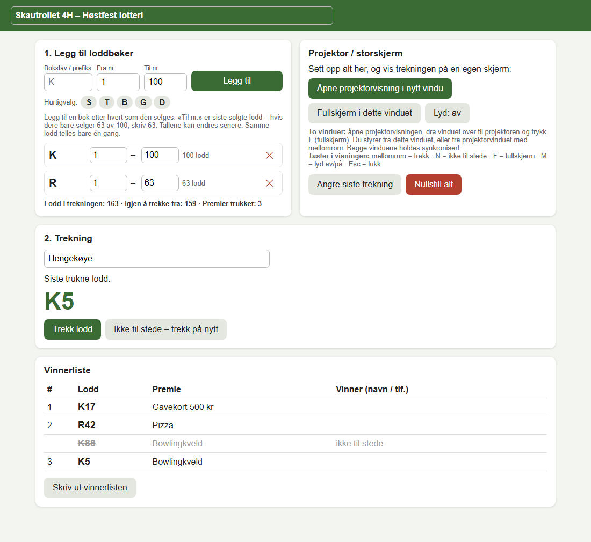
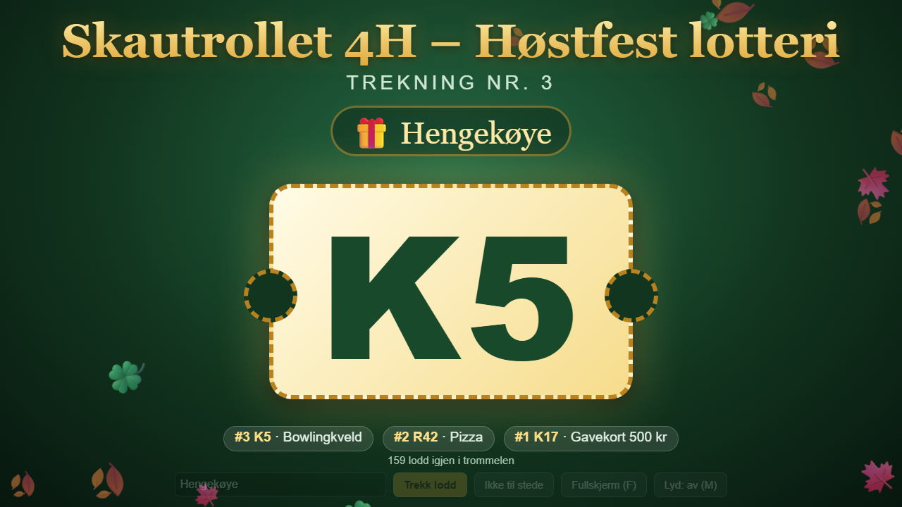

# Lotteritrekning

Et enkelt verktøy for å trekke vinnere i lotteri, laget for Skautrollet 4H. Alt ligger i én HTML-fil (`Lotteritrekning.html`). Du trenger ikke installere noe, og det trengs ingen server eller internettforbindelse.

## Skjermbilder

**Hovedvisning**: oppsett av loddbøker, trekning og vinnerliste.

**Projektorvisning**: vises på storskjerm under trekningen.

## Funksjoner

- Legg til loddbøker med bokstav/prefiks og nummerserie, for eksempel `K 1–63`.
- Trekning med rulleanimasjon, konfetti og valgfri lyd.
- Egen projektorvisning for storskjerm, som kan åpnes i et nytt vindu eller i fullskjerm.
- Premie kan oppgis for hver trekning.
- «Ikke til stede – trekk på nytt» markerer loddet som ugyldig og trekker et nytt.
- Angre siste trekning.
- Vinnerliste som kan skrives ut.
- Dataene lagres automatisk i nettleseren (`localStorage`), så de overlever en omlasting av siden.

## Kom i gang

1. Last ned `Lotteritrekning.html`.
2. Åpne filen i en moderne nettleser (Chrome, Edge, Firefox eller Safari).
3. Skriv inn navn på lotteriet øverst.
4. Under **1. Legg til loddbøker** fyller du inn bokstav, «Fra nr.» og «Til nr.», og trykker **Legg til**. «Til nr.» er siste solgte lodd. Tallene kan endres senere.
5. Skriv eventuelt inn en premie under **2. Trekning**, og trykk **Trekk lodd**.

## Projektorvisning

- **Åpne projektorvisning i nytt vindu**: dra vinduet over til projektoren og trykk `F` for fullskjerm. Du styrer fra det opprinnelige vinduet, eller fra projektorvinduet. De to vinduene holdes synkronisert.
- **Fullskjerm i dette vinduet**: viser trekningen i samme vindu.

Taster i visningen:

| Tast | Funksjon |
|------|----------|
| Mellomrom / Enter | Trekk lodd |
| `N` | Ikke til stede, trekk på nytt |
| `F` | Fullskjerm av/på |
| `M` | Lyd av/på |
| `Esc` | Lukk visningen |

## Om trekningen

Trekningen bruker `crypto.getRandomValues` uten modulo-skjevhet, så alle gjenværende lodd har like stor sjanse. Et lodd kan bare trekkes én gang, og samme loddnummer telles bare én gang selv om bøkene overlapper.

## Lisens

MIT-lisens. Se [LICENSE](LICENSE).

## Merknader

- Data lagres lokalt i nettleseren på den maskinen som brukes. Bruker du en annen nettleser eller maskin, starter du med et tomt oppsett.
- **Nullstill alt** sletter både loddbøker og trekninger.
- Navn og telefonnummer til vinnere må noteres for hånd i den utskrevne vinnerlisten.
